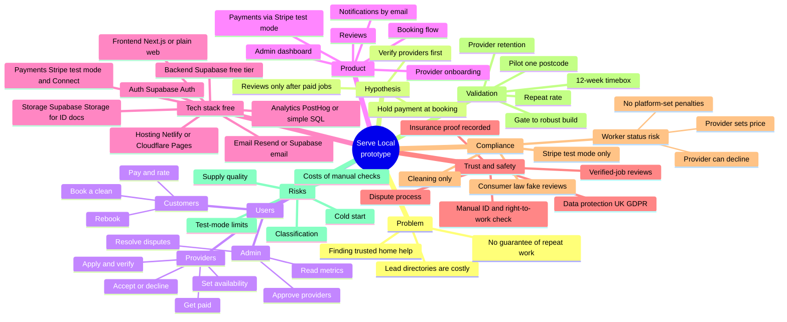

# 01 — Mind map

The whole project on one page. Renders on GitHub and in any Mermaid viewer.

## Reading the map

- **Problem and hypothesis** explain why the project exists.
- **Users** are the three sides a booking marketplace must serve.
- **Product** is the minimum we build. Anything not on this branch is out of scope.
- **Tech stack** is entirely free-tier; see [05-free-tech-stack.md](05-free-tech-stack.md).
- **Trust, compliance and risks** are the branches most likely to stop the project, so they get the most scrutiny.
