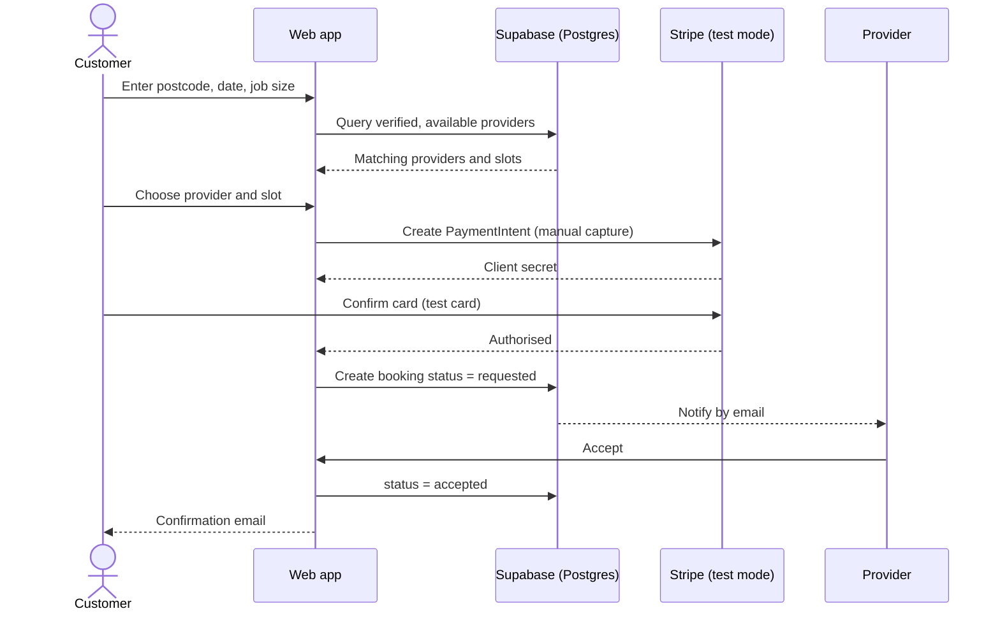
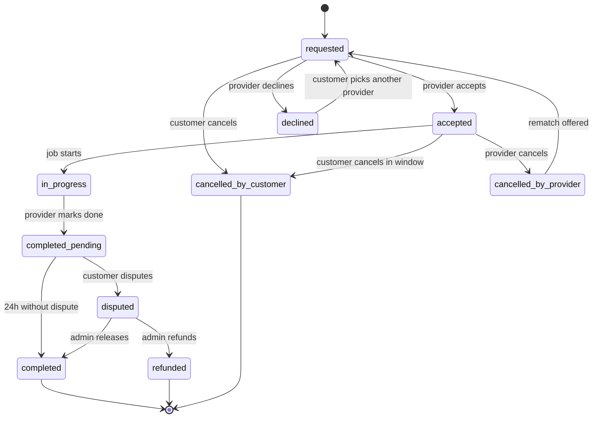
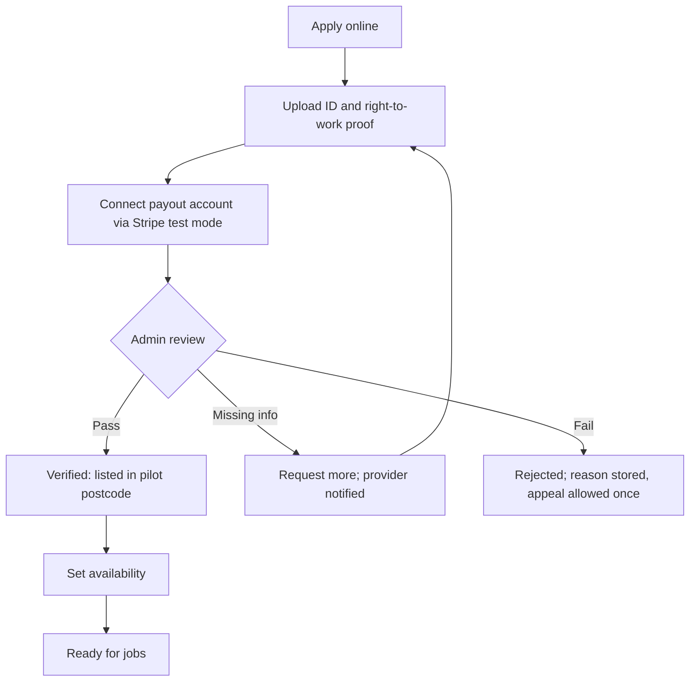
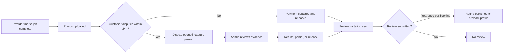
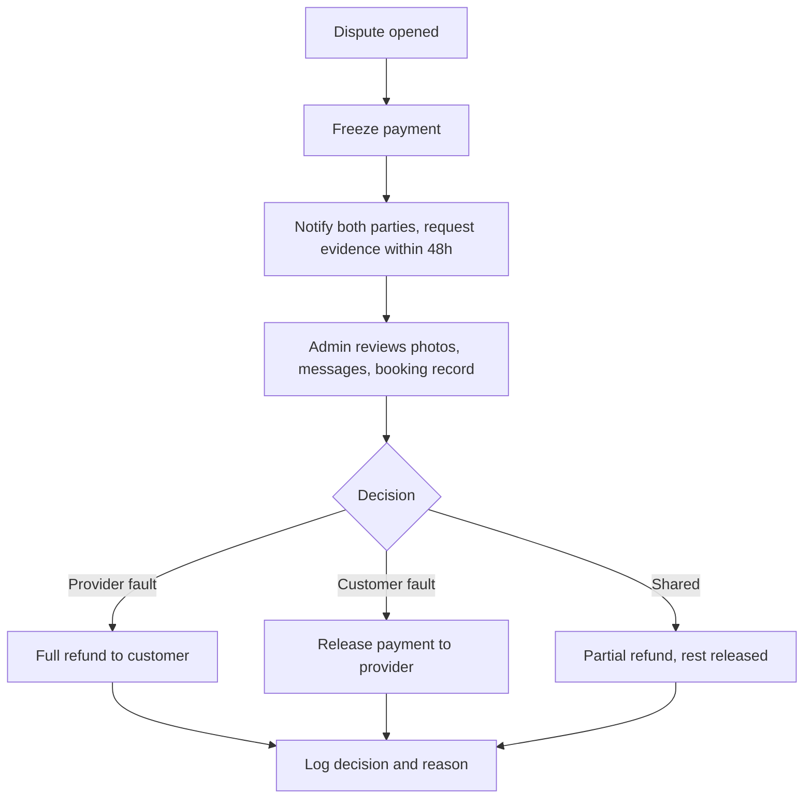

# 03 — User flows

Sequence and flow diagrams in Mermaid. Each flow lists the states it passes through, so developers can check the code against the diagram.

## 3.1 Customer books a clean

## 3.2 Booking state machine

Payment rules by state:

| State | Payment action |
|---|---|
| requested | Authorised, not captured |
| accepted | Still authorised |
| completed | Captured; provider payout scheduled |
| disputed | Capture paused |
| refunded | Authorisation cancelled or refunded |
| cancelled by customer in window | Authorisation cancelled, no charge |
| cancelled by customer outside window | Cancellation fee captured (amount set in config) |

## 3.3 Provider onboarding and verification

## 3.4 Job completion and review

## 3.5 Admin dispute handling

