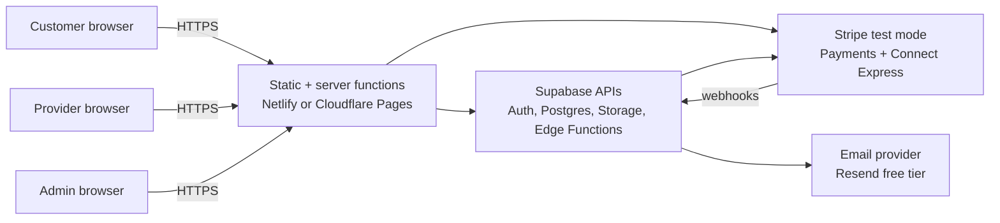
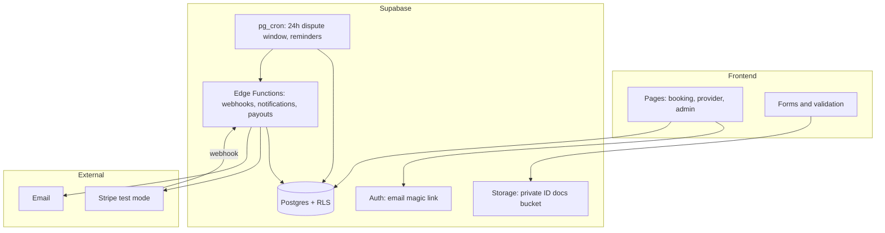
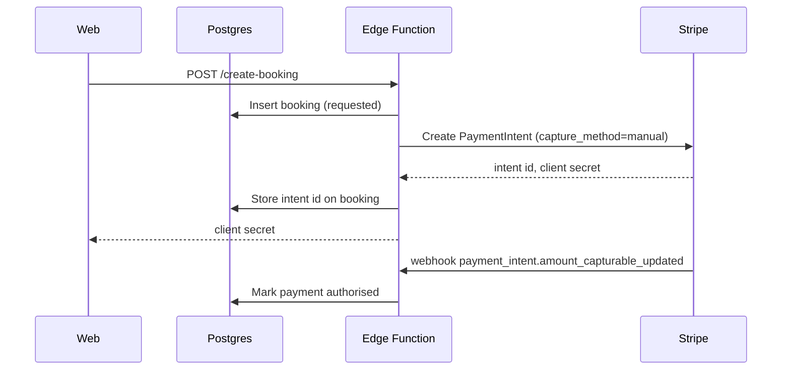

# 04 — Architecture

## System context

## Components

## Key design decisions

| Decision | Choice | Why | ADR |
|---|---|---|---|
| Business model | Booking-first, platform holds payment | Research: lead-gen directories shrinking; take rate needs transaction control | [0001](adr/0001-booking-first.md) |
| Backend | Supabase (Postgres, Auth, Storage) | Free tier covers a pilot; SQL and RLS are enough for a booking model | [0002](adr/0002-supabase-backend.md) |
| Payments | Stripe test mode, manual capture, Connect Express | Free to test; authorise-then-capture matches the state machine | [0003](adr/0003-stripe-test-mode-manual-capture.md) |
| Dispatch | None. Customers choose from a list | Avoids worker-status risk and dispatch complexity | [0001](adr/0001-booking-first.md) |
| Frontend | Responsive web app, no native app | One codebase, free hosting | — |
| Hosting | Netlify or Cloudflare Pages free tier | Static plus serverless, free for a pilot | — |

## Data flow for a booking

## Security basics (non-negotiable even in a prototype)

- Row-level security on every table (see `supabase/migrations/`).
- ID documents in a **private** storage bucket; access only through signed URLs for admins.
- Stripe secret key only in Edge Functions, never in the browser.
- Webhook signatures verified before any state change.
- No personal data in logs; no card numbers stored (Stripe holds them).
- Admin role set by the database, never by the client.

## Environments

| Environment | Purpose | Data |
|---|---|---|
| Local | Development | Seed data only |
| Staging (free Supabase project + Stripe test) | Pilot testing | Fake customers, test cards |
| Pilot (free tier, invite-only) | Real people, no real money | Real personal data — UK GDPR applies |

Real personal data enters the system at the pilot stage, so the consent and retention rules in [07](07-trust-safety-compliance.md) apply from day one.
