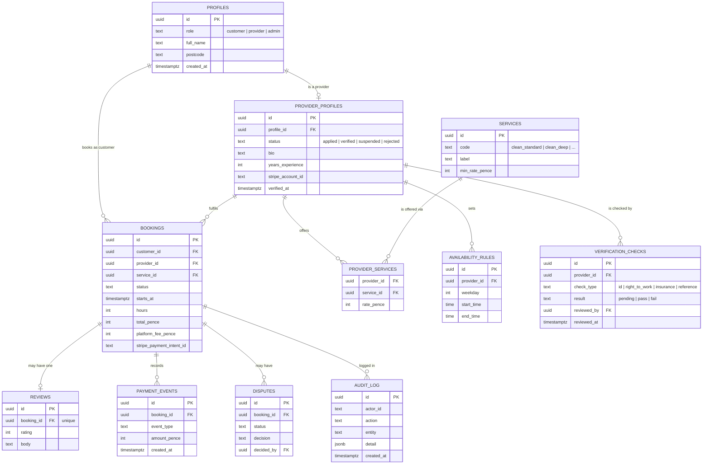

# 06 — Data model

Schema is in [`supabase/migrations/`](../supabase/migrations/). This page explains it.

## Entity relationship diagram

## Design rules

| Rule | Reason |
|---|---|
| Money in **integer pence** | Avoids floating-point errors |
| `bookings.status` follows the state machine in [03](03-user-flows.md) | One source of truth for payment decisions |
| One review per booking (unique constraint) | Only paid, completed jobs can be reviewed |
| `audit_log` is append-only | Supports dispute decisions and verification records |
| `verification_checks` keeps history, never overwrites | Shows what was checked and when |
| ID documents not in the database, only a storage path | Keeps sensitive files in a private bucket |
| Platform fee stored per booking | Lets us change the fee later without rewriting history |

## Row-level security (summary)

| Table | Customer | Provider | Admin |
|---|---|---|---|
| profiles | own row | own row | all |
| provider_profiles | public fields if verified | own row | all |
| bookings | own bookings | own bookings | all |
| verification_checks | none | none | all |
| reviews | create for own completed booking; read public | read own provider | all |
| disputes | create for own booking; read own | create for own booking; read own | all |
| audit_log | none | none | read; insert via functions only |

Full policies are in `supabase/migrations/`.

## Data we do **not** store

- Card numbers (Stripe holds them)
- Full ID document images in the database (only in the private bucket, deleted per retention rules)
- Health, criminal record or other special-category data (see [07](07-trust-safety-compliance.md))
