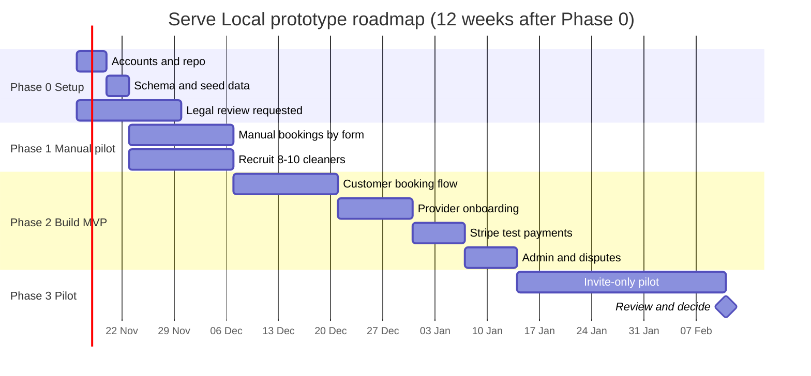

# 08 — Roadmap, validation plan and metrics

## Phases

Dates are placeholders. Shift them when Phase 0 starts.

## Phase detail

| Phase | Goal | Exit criteria |
|---|---|---|
| **0. Setup** (1–2 weeks) | Accounts, repo, schema, legal review requested | Schema runs on staging; Stripe test account live in test mode; terms drafted |
| **1. Manual pilot** (2–4 weeks) | Prove demand and rebooking with **no software** | 20+ bookings; at least 8 customers who book twice; 8 cleaners checked by hand |
| **2. Build MVP** (4–6 weeks) | The minimum app from [02](02-user-stories.md) P0 stories | Staging flows pass the test script below |
| **3. Pilot** (4 weeks) | Real customers and providers, one postcode, no real money | Metrics reviewed at weeks 2 and 4 |
| **4. Decide** | Go / adjust / stop | Recorded in an ADR |

## Phase 1 in detail: manual pilot (do this first)

Before writing app code, run the service by hand.

1. Put up a simple booking form (Google Form or Tally, both free) with postcode, date, hours, and contact.
2. Match each request by phone or WhatsApp to a cleaner you have checked yourself.
3. Take payment by bank transfer or a free card link (test only if using Stripe).
4. After each job, ask the customer for a rating and whether they'd book again.
5. Track in a spreadsheet: request time, matched time, accepted (y/n), completed (y/n), rebooked within 30 days (y/n), rating.

This tests the three things the app depends on: whether customers book, whether cleaners accept, and whether they come back. If Phase 1 fails these, do not build Phase 2.

## Test script for the MVP (Phase 2 exit)

| # | Test | Expected result |
|---|---|---|
| T1 | Customer signs up, verifies email | Account created, can book |
| T2 | Customer searches a postcode with no providers | Clear "no providers" message, no error |
| T3 | Customer books with test card 4242 4242 4242 4242 | Booking requested; payment authorised, not captured |
| T4 | Provider declines | Customer notified; can pick another provider; no charge |
| T5 | Provider accepts, marks complete | Status moves to completed_pending |
| T6 | Customer does not dispute for 24h | Payment captured; review invitation sent |
| T7 | Customer disputes | Payment paused; admin sees the dispute |
| T8 | Customer submits a review for a paid booking | Review published once |
| T9 | Customer tries a second review for the same booking | Rejected |
| T10 | Customer tries to see another customer's bookings | Blocked by RLS |
| T11 | Provider uploads ID | File in private bucket; not visible to other users |
| T12 | Non-admin tries admin page | Blocked |

Use Stripe's test cards and webhook CLI for T3, T6 and T7. Record results in `docs/test-results/`.

## Metrics dashboard (weekly)

| Metric | Definition | Pilot target | Source |
|---|---|---|---|
| Requests | Booking requests per week | Growing week on week | bookings table |
| Fill rate | Requests with an accepted provider within 24h | ≥ 80% | bookings |
| Completion rate | Accepted bookings that complete | ≥ 90% | bookings |
| Second-booking rate | Customers booking again within 30 days | ≥ 35% | bookings |
| Provider retention | Providers with at least one job in week 8 | ≥ 70% | bookings |
| Average rating | Mean of verified-job reviews | ≥ 4.5 | reviews |
| Dispute rate | Disputes ÷ completed bookings | Under 5% | disputes |
| Cost per booking | Free-tier usage, plus admin time | Trend only | manual log |

Targets are working hypotheses. Adjust them after Phase 1 data.

## Decision gate (end of Phase 3)

| Result | Decision |
|---|---|
| Second-booking ≥ 35%, provider retention ≥ 70%, fill rate ≥ 80% | Build the more robust version: add payments in live mode after compliance review, second postcode, and a second service |
| Two of three targets met | Adjust (usually pricing, supply or matching) and run another 4 weeks |
| One or none met | Stop or pivot. Record the reason in an ADR |

## What "more robust" will mean (decided only after the gate)

- Live Stripe with full compliance, insurance and terms
- Automated ID verification and right-to-work checks
- Second and third postcode, with supply-first onboarding
- Recurring bookings and provider preferences
- Native-quality mobile experience (PWA first)
- A decision on worker-status model, with legal advice
- Proper monitoring, backups and an on-call process
