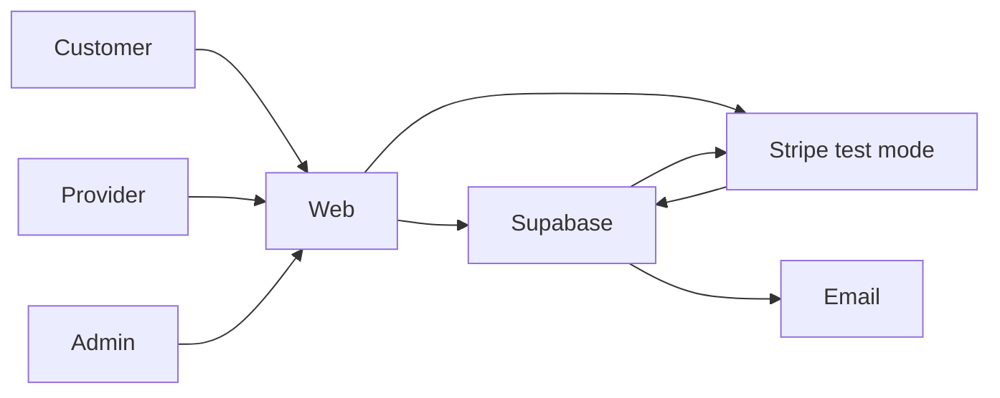

# Diagrams index

Standalone copies of the main diagrams. The same diagrams appear in context in the docs; this file is for quick reference and for importing into tools that read Mermaid.

## Phase roadmap
See [08-roadmap-and-validation.md](../08-roadmap-and-validation.md).

## Booking state machine
See [03-user-flows.md §3.2](../03-user-flows.md).

## System context

## Mind map
See [01-mindmap.md](../01-mindmap.md).

## Entity relationship diagram
See [06-data-model.md](../06-data-model.md).

To render any diagram locally for free: paste into https://mermaid.live, or let GitHub render the `.md` file directly.
